# Viobot 录制手册

面向已经部署好的viobot设备进行数据录制工作。相机服务和录包服务均已配置为开机自启动，使用时通常只需要上电、等待初始化完成、检查录制状态、停止录制和取数据，不需要重新安装服务或修改脚本。viobot当前ip地址配置为`192.168.137.231`，用户名root，密码为PRR，注意需要在同一网段才能访问，官方手册地址见[这里](https://baton-doc.readthedocs.io/en/viobot2/)。

## 目录
- [采集规范](#采集规范)
- [服务与数据位置](#服务与数据位置)
- [录制流程](#录制流程)
- [录制前检查](#录制前检查)
- [上电后等待](#上电后等待)
- [确认录制正常](#确认录制正常)
- [需要时手动重启服务](#需要时手动重启服务)
- [停止录制](#停止录制)
- [查看数据与日志](#查看数据与日志)
- [修复异常中断的 Bag](#修复异常中断的-bag)
- [传输数据到本地](#传输数据到本地)
- [传输数据到foxglove](#传输数据到foxglove)
- [常见异常检查](#常见异常检查)
- [硬件](#硬件)

## 采集规范

- 采集开始时，选择视野开阔、环境较为空旷的区域进行初始化，等待一分钟左右后先沿直线路径行驶数十米，以完成系统状态收敛。
- 采集过程中，将行驶速度控制在10–20 km/h。
- 在道路条件允许的情况下，尽量沿道路中线行驶。
- 骑行策略以平稳为主，避免急加速、急减速和剧烈转向。遇到复杂交通环境、行人密集区域或定位质量较差的场景时，可选择减速、停车等待或下车推行。
- 转弯时尽量通过转动车把完成方向调整，尽量避免压弯；采集过程中尽可能保持车身水平。

## 服务与数据位置

已部署服务：

- 相机服务：`ros2_viobot_cam.service`
- 录包服务：`ros2_viobot_ctrl_bag.service`

默认数据目录：

```bash
/data/upload/
```

单次录制目录命名：

```bash
/data/upload/bag_YYYYmmdd_HHMMSS
```

主要日志：

```bash
/data/upload/log/cam.log
/data/upload/log/bag.log
/data/upload/log/monitor_<bag_name>/
```

默认录制话题：

- `/baton/gnss/ephem`
- `/baton/gnss/meas`
- `/baton/stereo3/odometry`
- `/baton/algo_status`
- `/camera_x001/image_raw/compressed`
- `/baton/gnss/status`
- `/baton/gnss/spp_fix_raw`
- `/baton/gnss/spp_fix`
- `/baton/gnss/heading`

## 录制流程

附[启动检查视频](./docs/vids/startup.mp4)以及[结束检查视频](./docs/vids/shutdown.mp4)。

每次采集建议按这个顺序执行：

1. 将设备放在适合GNSS接收的位置，上电。
2. 等待系统、ROS节点、相机节点和录包脚本自动启动。
3. 检查相机服务、录包服务和新bag目录。
4. 等待冷启动完成，不要过早开始正式运动采集，等待大约60-90秒。
5. 采集过程中按需查看相机话题、算法状态、GNSS状态和监控日志。
6. 采集结束后先停止录包服务，再停止相机服务。
7. 使用`ros2 bag info`检查数据。
8. 传输数据到本地进行后处理。

## 录制前检查

这些检查可以在上电前或上电后执行。录制服务会自动启动，所以重点是确认设备状态是否满足本次采集。

### 1. 检查磁盘空间

```bash
df -h /data/upload
```

如果空间不足，先转移或删除旧数据。

### 2. 检查相机设备

```bash
ls -lh /dev/video*
```

设备正常时应能看到视频设备。实际设备号以现场系统分配和相机日志为准，对于`viobot`应为 `/dev/video40`。

### 3. 检查服务状态

```bash
systemctl status ros2_viobot_cam.service
systemctl status ros2_viobot_ctrl_bag.service
```

如果服务处于 `failed`，可先重置状态：

```bash
sudo systemctl reset-failed ros2_viobot_cam.service
sudo systemctl reset-failed ros2_viobot_ctrl_bag.service
```

### 4. 检查 ROS 话题

```bash
ros2 topic list | grep baton
```

若看不到任何 `/baton/...` 话题，通常说明底层ROS驱动或启动服务还没准备好，可以尝试重启设备。

## 上电后等待

设备上电后，相机服务和录包服务会自动启动。

### 1. 系统与程序初始化

上电后先等待系统启动、`ros2-startup.service`、相机服务和录包服务完成初始化。脚本中还有固定等待：

- `start_cam.sh`：加载环境后等待 15 秒，再启动 `cam_pub`。
- `start_bag.sh`：先等待核心驱动节点 25 秒，再启用 Stereo3 和启动 GNSS SPP。
- `start_bag.sh`：随后等待 `/baton/algo_status` 出现 `stereo3_running`，等待超时为 15 秒。

建议上电后至少等待**1分钟**再开始运动采集。刚上电时服务状态短暂显示启动中或日志还在追加是正常的。

可用下面的命令观察状态：

```bash
ros2 topic hz /camera_x001/image_raw/compressed
ros2 topic echo /baton/algo_status --once
ros2 topic echo /baton/gnss/status --once
```

如果 `/baton/gnss/spp_fix_raw` 已经有输出，说明原始 GNSS SPP fix 已经开始发布：

```bash
ros2 topic echo /baton/gnss/spp_fix_raw --once
```

如果 `/baton/gnss/status` 从 `gnss_waiting_origin`、`gnss_aligning` 进入 `gnss_fusing`，说明 GNSS 与 Stereo3 融合链路已经进入融合状态。

### 2. 自动录制

```bash
systemctl status ros2_viobot_cam.service
systemctl status ros2_viobot_ctrl_bag.service
```

如果录包服务正常运行，`/data/upload` 下会自动出现新的 `bag_...` 目录。

## 确认录制正常

### 1. 看是否生成新的 bag 目录

```bash
ls -lt /data/upload | head
```

最新目录应类似：

```text
bag_20260521_153000
```

### 2. 看录包日志

```bash
tail -n 80 /data/upload/log/bag.log
```

确认没有明显的`timeout` 或 `failed`。

### 3. 看相机日志

```bash
tail -n 80 /data/upload/log/cam.log
```

确认没有相机打开失败、连续超时或反复重启。

### 4. 看算法状态

```bash
ros2 topic echo /baton/algo_status --once
```

录制脚本会等待算法状态为`stereo3_running`才正式开始录制。如果状态一直不变，说明算法还没进入正常运行状态，需要继续等待或重启设备。

## 需要时手动重启服务

正常采集不需要手动启动服务。只有在确认服务失败、需要重新开始一段新录制，或停止后想重新录制时，才手动重启。

### 重启相机服务

```bash
sudo systemctl restart ros2_viobot_cam.service
```

重启后检查：

```bash
systemctl status ros2_viobot_cam.service
ros2 topic hz /camera_x001/image_raw/compressed
```

### 重启录包服务

重启录包服务会结束当前录制并创建新的 bag 目录：

```bash
sudo systemctl restart ros2_viobot_ctrl_bag.service
```

重启后检查：

```bash
systemctl status ros2_viobot_ctrl_bag.service
ls -lt /data/upload | head
tail -n 80 /data/upload/log/bag.log
```

## 停止录制

采集结束时，先停止录包，再停止相机：

```bash
sudo systemctl stop ros2_viobot_ctrl_bag.service
sudo systemctl stop ros2_viobot_cam.service
```

停止后等待几秒，让bag metadata正常写完。

确认服务已停止：

```bash
systemctl status ros2_viobot_ctrl_bag.service
systemctl status ros2_viobot_cam.service
```

## 查看数据与日志

### 1. 查看最新数据

```bash
ls -lt /data/upload | head
```

### 2. 查看 bag 信息

```bash
ros2 bag info /data/upload/bag_YYYYmmdd_HHMMSS
```

### 3. 查看 bag 文件大小

```bash
ls -lh /data/upload/bag_YYYYmmdd_HHMMSS
```

录制使用 MCAP，并按 60 秒分段。如果采集时间较长，目录中会有多个分段文件。

### 4. 查看服务实时日志

```bash
journalctl -u ros2_viobot_cam.service -f
journalctl -u ros2_viobot_ctrl_bag.service -f
```

### 5. 查看历史日志

```bash
journalctl -u ros2_viobot_cam.service -n 100 --no-pager
journalctl -u ros2_viobot_ctrl_bag.service -n 100 --no-pager
```

## 修复异常中断的 Bag

如果设备断电、强制关机，或者`ros2 bag info`失败，可以运行修复脚本：

```bash
bash /root/viobot_ctrl/bash/fix_bag.sh /data/upload/bag_YYYYmmdd_HHMMSS
```

修复脚本会执行以下操作：

- 解压 `.mcap.zstd` 文件。
- 备份原始压缩文件到 `backup_zstd/`。
- 隔离过小、疑似损坏的尾部分块到 `corrupted_chunks/`。
- 执行 `ros2 bag reindex`。
- 输出修复后的 `ros2 bag info`。

## 传输数据到本地

可以使用 `rsync` 从本地传输数据，viobot 设备 IP 地址为`192.168.137.231`：
```bash
rsync -avz root@192.168.137.231:/data/upload/bag_YYYYmmdd_HHMMSS /path/to/local_data/
```

## 传输数据到foxglove

设备配置了foxglove agent来自动上传数据到foxglove云端，上传后可以在foxglove web中查看和分析数据。注意要插上随身wifi。

```bash
systemctl restart foxglove-agent.service
```
并查看日志：

```bash
journalctl -u foxglove-agent.service -f
```


## 常见异常检查

### 录包服务启动失败

查看最近日志：

```bash
journalctl -u ros2_viobot_ctrl_bag.service -n 100 --no-pager
tail -n 120 /data/upload/log/bag.log
```

重点检查以下问题：

- 是否等不到`stereo3_running`。
- `/data/upload` 是否空间不足。
- 底层ROS启动服务是否正常。
- `/baton/algo_status`是否有输出。

### 等不到 `stereo3_running`

```bash
ros2 topic echo /baton/algo_status --once
ros2 topic info /baton/stereo3_ctrl
```

若状态一直不变，可尝试重启。


### 数据目录没有新 bag

```bash
systemctl status ros2_viobot_ctrl_bag.service
tail -n 120 /data/upload/log/bag.log
ls -lt /data/upload | head
```

如果日志显示等待状态超时，说明录包还没真正开始。

### 录制过程中确认设备还在正常工作

```bash
ros2 topic hz /camera_x001/image_raw/compressed
ros2 topic echo /baton/gnss/status --once
ls -lh /data/upload/bag_YYYYmmdd_HHMMSS
```

## 硬件

### 1. 滑板车
滑板车密码为5211。  
充电接口在车把下方，使用随车充电器连接220V交流电。其他操作教程在[这里](https://support.ninebot.com/cn-zh/pdf?pdfUrl=https%253A%252F%252Fai-kb-private.ninebot.com%252Fai_kb%252F1761888941742_%2525E4%2525B9%25259D%2525E5%25258F%2525B7%2525E7%252594%2525B5%2525E5%25258A%2525A8%2525E6%2525BB%252591%2525E6%25259D%2525BF%2525E8%2525BD%2525A6F2Pro%2525E6%252596%2525B0%2525E5%25259B%2525BD%2525E6%2525A0%252587%2525E8%2525AF%2525B4%2525E6%252598%25258E%2525E4%2525B9%2525A6.pdf%253Fe%253D1780563783%2526token%253DIAM-2Snxhovigh9PO2Zci9b9ER0HgbXGHJ-NcMikkDc8%253AZ3A63rgDLh_Yt0P1qUSWLPNIgwQ%253D&openType=3&subCategoryCode=H1&seriesCode=K097&subSeriesName=%E4%B9%9D%E5%8F%B7%E7%94%B5%E5%8A%A8%E6%BB%91%E6%9D%BF%E8%BD%A6F2+Pro)。
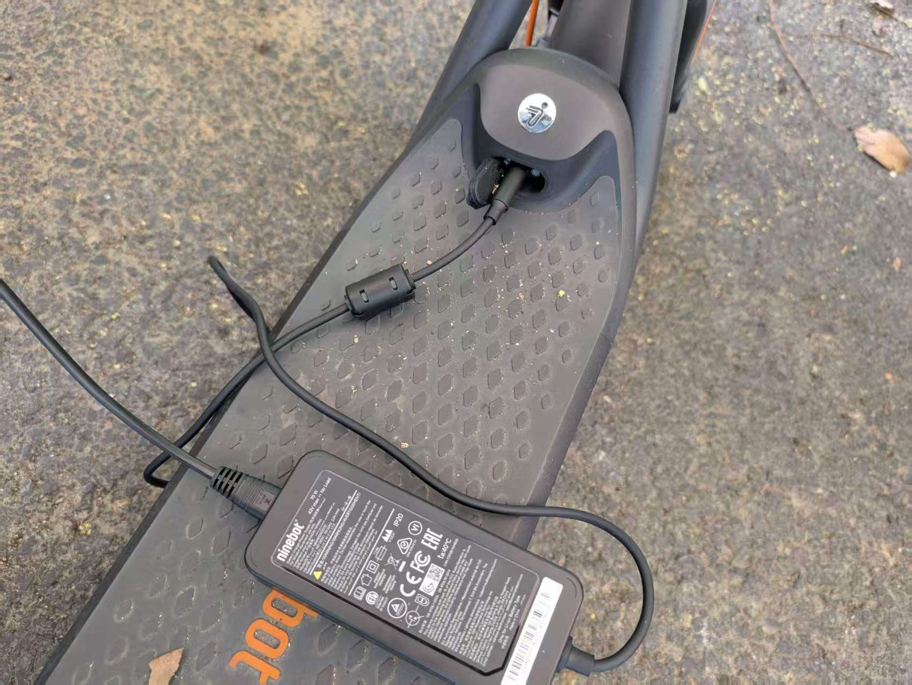
滑板车面板位置安装了viobot和gnss的支撑平台，viobot背面有魔术贴，直接贴在平台上，gnss天线底座有磁性，可以吸附在平台左侧的平台上。
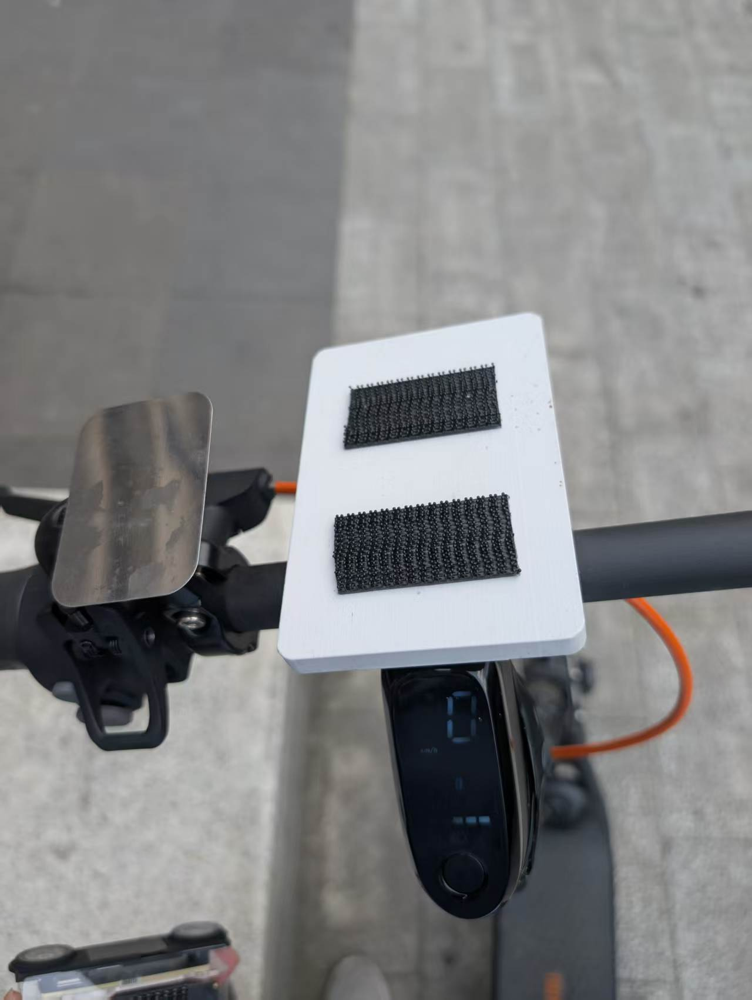
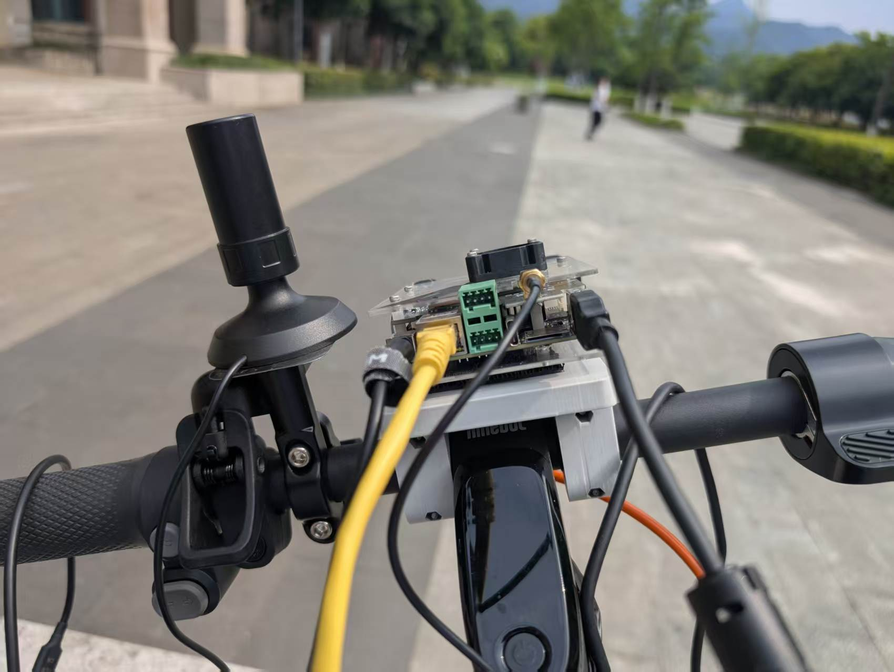
相机安装在连杆靠下方位置，朝前方，用螺丝固定在平台上。
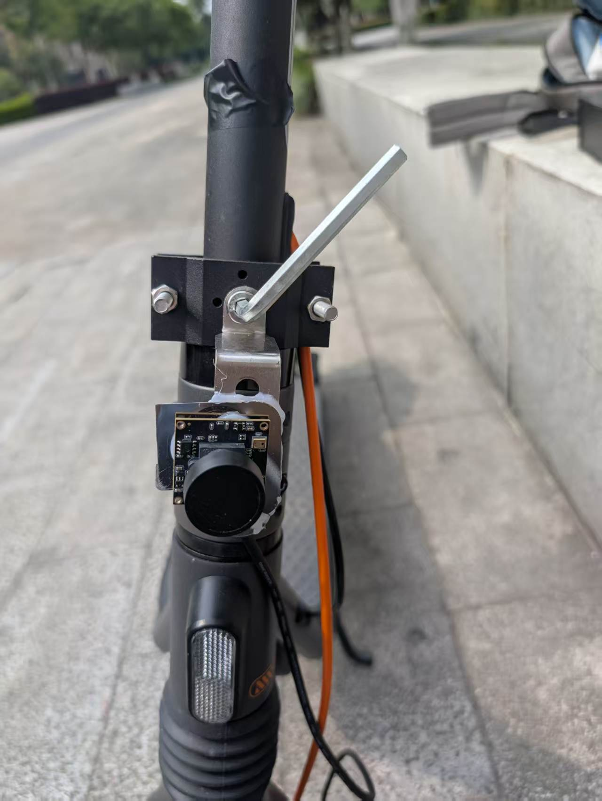

### 2. viobot
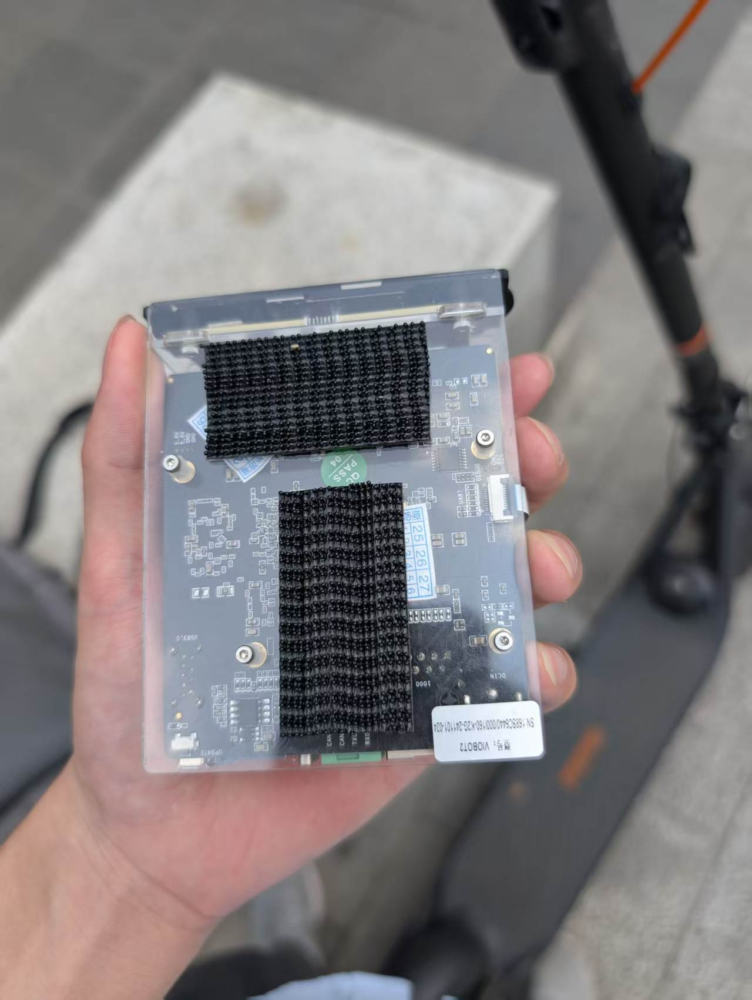
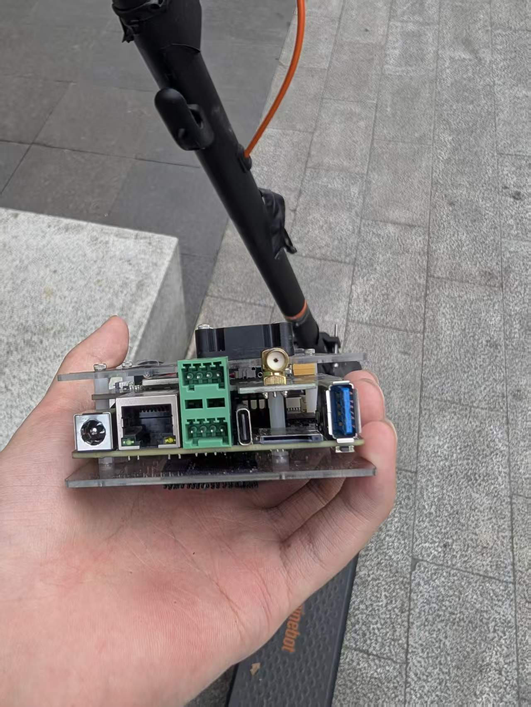

### 3. GNSS天线
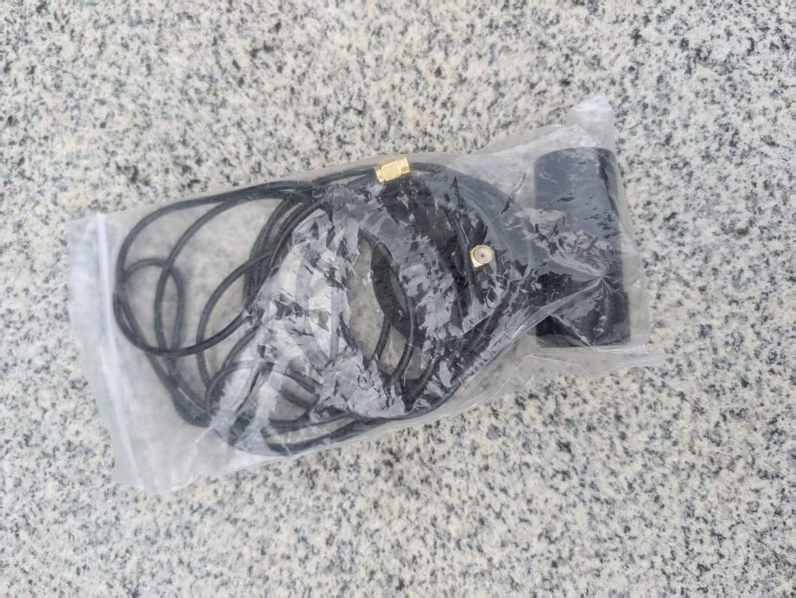

### 4. 相机
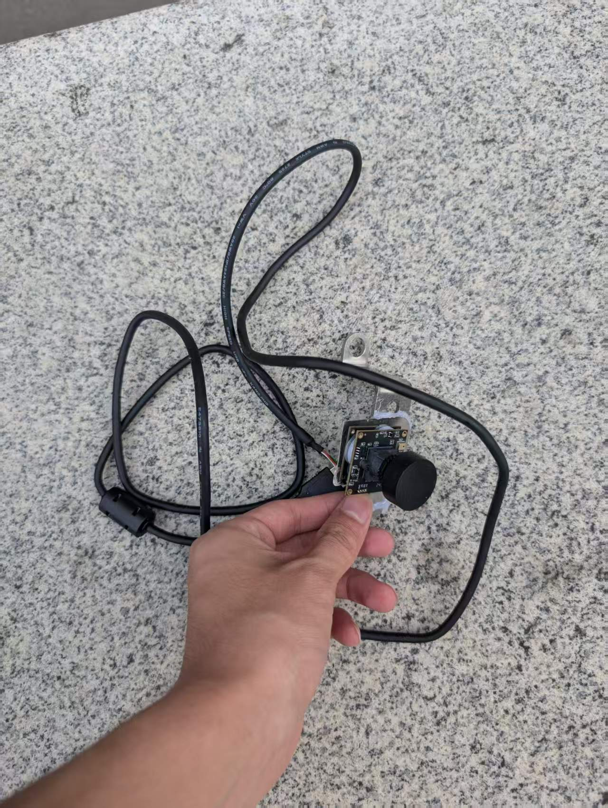

### 5. 随身wifi
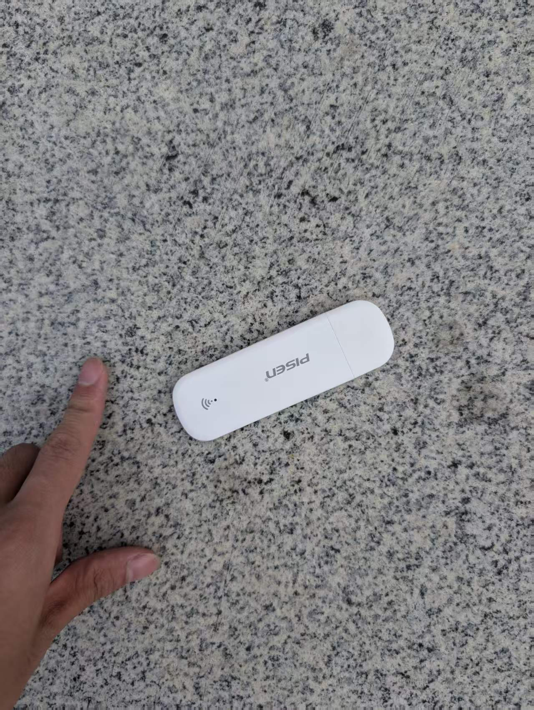

### 6. 连接线
原厂供电线：
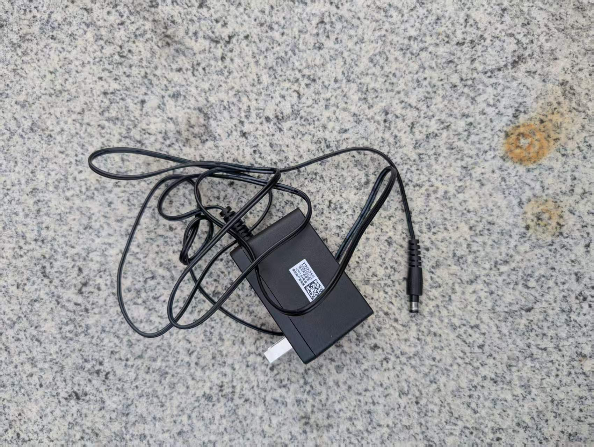
充电宝供电线：
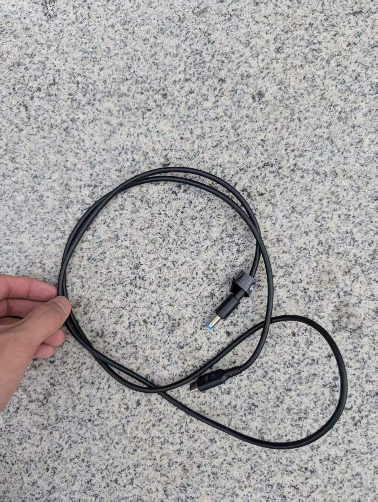
