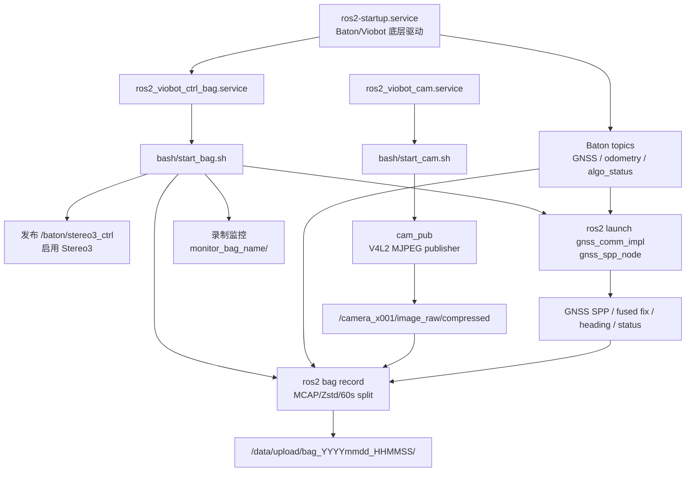

# Viobot 数据录制技术实现

`Locomotion_part/viobot_ctrl` 是 Urban-Nav-SR 的 Viobot 数据录制子项目。它以 [`bash/start_bag.sh`](bash/start_bag.sh) 为主入口，负责在设备端启动定位链路、监控录制状态，并将 GNSS、Stereo3、相机和融合结果同步写入 ROS 2 MCAP bag。

相关文档：

- [项目总览](README_zh.md)
- [外场录制手册](DATA_RECORDING_MANUAL_zh.md)
- [录制入口脚本](bash/start_bag.sh)

## 目录

- [目标与范围](#目标与范围)
- [系统架构](#系统架构)
- [录制启动流程](#录制启动流程)
- [数据流与话题约定](#数据流与话题约定)
- [组件设计](#组件设计)
- [存储与日志](#存储与日志)
- [配置项](#配置项)
- [后处理工具](#后处理工具)
- [故障定位](#故障定位)
- [代码结构](#代码结构)

## 目标与范围

**稳定采集可复现、可后处理的外场导航数据**。

录制内容分为三类：

- **原始传感输入**：GNSS 星历、GNSS 观测值、Stereo3 odometry、相机压缩图像。
- **在线状态与控制结果**：Stereo3 算法状态、GNSS 融合状态。
- **在线定位输出**：原始 SPP fix、Stereo3/GNSS 融合 fix、航向角。

设计原则：

- **先验证状态，再录制**：`start_bag.sh` 会等待 Stereo3 进入 `stereo3_running` 后才启动 `ros2 bag record`。
- **保留原始输入**：bag 中同时保存原始 GNSS/odometry 和在线融合结果，便于离线复算和修复。
- **录制可观测**：每次录制都会生成独立监控日志，记录话题、进程、磁盘、内存和内核状态。
- **异常可恢复**：MCAP 按 60 秒分段写入，并提供 `fix_bag.sh` 重建索引。

## 系统架构

部署后通常由两个 systemd 服务分别管理录包链路和相机链路。



核心角色：

| 模块 | 入口 | 职责 |
| --- | --- | --- |
| 录制编排 | [`bash/start_bag.sh`](bash/start_bag.sh) | 加载环境、启用 Stereo3、启动 GNSS 节点、等待状态、启动录包和监控 |
| 相机发布 | [`bash/start_cam.sh`](bash/start_cam.sh)、[`src/cam_pub`](src/cam_pub) | 从 V4L2 设备采集 MJPEG 帧，发布压缩图像 |
| GNSS 融合 | [`src/gnss_comm_impl`](src/gnss_comm_impl) | GNSS SPP 解算、Stereo3/GNSS 动态对齐、融合 fix 和 heading 发布 |
| 算法控制 | [`src/viobot_ctrl`](src/viobot_ctrl) | 发布 Stereo3 控制命令，提供自动启动辅助节点 |
| 数据修复 | [`bash/fix_bag.sh`](bash/fix_bag.sh)、[`scripts`](scripts) | 修复异常 bag，分析跳变，生成离线修复轨迹 |

## 录制启动流程

`start_bag.sh` 是录制链路的主入口。一次录制从服务启动到 bag 落盘的顺序如下。

### 1. 加载 ROS 2 与部署环境

脚本会加载 ROS 2 Humble、Baton 工作区和 `viobot_ctrl` 工作区：

```bash
export ROS_HOME=/root
source /opt/ros/humble/setup.bash
source /root/Baton/install/local_setup.bash --extend
source /root/viobot_ctrl/install/local_setup.bash --extend
```

`ROS_DOMAIN_ID` 从 `/home/PRR/.bashrc` 中提取并执行，使录制脚本与底层驱动处于同一个 ROS 2 domain。

### 2. 等待底层驱动上线

脚本固定等待 25 秒，给 `ros2-startup.service`、Baton 驱动、GNSS 数据源和 Stereo3 基础话题预留初始化时间。

### 3. 启用 Stereo3

脚本向 `/baton/stereo3_ctrl` 发布一次 `system_ctrl/msg/AlgoCtrl`：

```yaml
algo_enable: true
algo_reboot: false
algo_reset: false
```

这是当前部署路径中的 Stereo3 启动方式。同时 `src/viobot_ctrl` 还保留了 `stereo3_auto_start_node`，可用于收到首个 GNSS fix 后再启用 Stereo3 的策略。

### 4. 启动 GNSS SPP 节点

脚本后台启动：

```bash
ros2 launch gnss_comm_impl gnss_spp_node.launch.py
```

该 launch 运行 `gnss_comm_impl/app_node`，默认参数来自 [`src/gnss_comm_impl/config/gnss_spp_node.yaml`](src/gnss_comm_impl/config/gnss_spp_node.yaml)。

### 5. 等待算法状态确认

正式录制前，脚本最多等待 15 秒，要求 `/baton/algo_status` 出现：

```text
stereo3_running
```

若超时或状态不匹配，脚本直接退出，不启动 bag 录制。这可以避免生成缺少核心定位数据的无效采集文件。

### 6. 创建输出目录

默认数据根目录：

```text
/data/upload
```

单次录制目录：

```text
/data/upload/bag_YYYYmmdd_HHMMSS
```

如果目录已存在，脚本会自动追加 `_1`、`_2` 等后缀，避免覆盖历史数据。

### 7. 启动监控

录制前调用 `start_monitoring`，创建：

```text
/data/upload/log/monitor_<bag_name>/
```

监控进程会记录相机话题、关键进程、磁盘、内存、负载、bag 目录和 `dmesg`。脚本退出时会统一清理监控进程。

### 8. 启动 rosbag2 录制

核心录制命令：

```bash
ros2 bag record \
  /baton/gnss/ephem \
  /baton/gnss/meas \
  /baton/stereo3/odometry \
  /baton/algo_status \
  /camera_x001/image_raw/compressed \
  /baton/gnss/status \
  /baton/gnss/spp_fix_raw \
  /baton/gnss/spp_fix \
  /baton/gnss/heading \
  --storage mcap \
  --storage-config-file /root/viobot_ctrl/bash/mcap_config.yaml \
  --qos-profile-overrides-path /root/viobot_ctrl/bash/qos_overrides.yaml \
  --max-cache-size "$BAG_MAX_CACHE_SIZE" \
  --max-bag-duration 60 \
  -o "$BAG_NAME"
```

写入策略：

- 使用 MCAP storage。
- 使用 Zstd `Fastest` 压缩。
- 每 60 秒切分一个 bag 分段。
- 相机话题使用 best-effort QoS override。
- `BAG_MAX_CACHE_SIZE` 默认 `536870912` 字节，可通过环境变量覆盖。

### 9. 退出

脚本注册了 `EXIT`、`INT`、`TERM` trap。退出时按顺序：

1. 向 `ros2 bag record` 发送 `SIGINT`，让 rosbag2 写完 metadata。
2. 向 GNSS launch 发送 `SIGINT`，必要时再发送 `SIGTERM`。
3. 停止所有监控进程。
4. 保留原始退出码。

systemd unit 也配置了 `KillSignal=SIGINT`、`TimeoutStopSec=15` 和 `KillMode=mixed`，与脚本清理逻辑保持一致。

## 数据流与话题约定

录制话题覆盖原始数据、在线状态和在线定位输出。

| 话题 | 类型 | 来源 | 用途 |
| --- | --- | --- | --- |
| `/baton/gnss/ephem` | `gnss_comm/msg/GnssEphemMsg` | Baton/Viobot GNSS 驱动 | 卫星星历，支持在线和离线 SPP 解算 |
| `/baton/gnss/meas` | `gnss_comm/msg/GnssMeasMsg` | Baton/Viobot GNSS 驱动 | 单历元多星观测值，包含伪距、载波、CN0 等 |
| `/baton/stereo3/odometry` | `nav_msgs/msg/Odometry` | Stereo3 | 高频相对里程计，融合与后处理的核心轨迹源 |
| `/baton/algo_status` | `system_ctrl/msg/AlgoStatus` | Baton/Viobot 算法状态 | 记录 Stereo3 状态，并作为录制启动门控 |
| `/camera_x001/image_raw/compressed` | `sensor_msgs/msg/CompressedImage` | `cam_pub` | 前向相机 JPEG 压缩图像 |
| `/baton/gnss/status` | `system_ctrl/msg/AlgoStatus` | `gnss_spp_node` | GNSS/融合状态机 |
| `/baton/gnss/spp_fix_raw` | `sensor_msgs/msg/NavSatFix` | `gnss_spp_node` | 原始 SPP 全局定位 |
| `/baton/gnss/spp_fix` | `sensor_msgs/msg/NavSatFix` | `gnss_spp_node` | Stereo3/GNSS 融合全局轨迹 |
| `/baton/gnss/heading` | `std_msgs/msg/Float64` | `gnss_spp_node` | 融合后的航向角，单位为度 |

`/baton/gnss/status` 的状态值：

| 状态 | 含义 |
| --- | --- |
| `gnss_idle` | Stereo3 未运行，或 GNSS 融合状态已复位 |
| `gnss_waiting_origin` | Stereo3 已运行，正在等待稳定 GNSS 原点 |
| `gnss_aligning` | 原点已建立，正在等待 odometry/GNSS 对齐收敛 |
| `gnss_fusing` | 动态对齐成功，正在发布融合轨迹 |

## 组件设计

### 相机链路

入口：

- [`bash/start_cam.sh`](bash/start_cam.sh)
- [`src/cam_pub/src/cam_pub.cpp`](src/cam_pub/src/cam_pub.cpp)

启动命令：

```bash
ros2 run cam_pub cam_pub --ros-args -p framerate:="$CAMERA_FRAMERATE"
```

默认参数：

- `video_device`: `/dev/video40`
- `image_width`: `1920`
- `image_height`: `1080`
- `framerate`: `20.0`
- `topic_name`: `/camera_x001/image_raw/compressed`
- `qos_depth`: `10`
- `dqbuf_timeout_ms`: `2000`
- `max_consecutive_timeouts`: `5`

实现要点：

- 通过 V4L2 打开 MJPEG 设备。
- 使用 `mmap` buffer 获取压缩帧。
- 直接发布 `sensor_msgs/msg/CompressedImage`，`format="jpeg"`。
- 发布端 QoS 为 best-effort。
- 连续取帧超时后主动退出，由 systemd 按 `Restart=on-failure` 重启。

### GNSS SPP 节点

入口：

- [`src/gnss_comm_impl/src/app_node.cpp`](src/gnss_comm_impl/src/app_node.cpp)
- [`src/gnss_comm_impl/include/gnss_comm_impl/app_node.hpp`](src/gnss_comm_impl/include/gnss_comm_impl/app_node.hpp)

处理流程：

1. 校验星历和观测消息。
2. 按卫星匹配观测值和星历。
3. 过滤不健康或过期星历。
4. 提取 L1 观测，并使用 Hatch filter 平滑伪距。
5. 剔除卫星数不足的弱势星座。
6. 调用 `gnss_comm::psr_pos` 求解 ECEF 坐标。
7. 应用 `gnss.initial_calibration_enu` 初始标定偏移。
8. 转换为 WGS84 经纬高，发布 `/baton/gnss/spp_fix_raw`。

节点会拒绝非有限数值、异常 ECEF 范数和明显越界高度，降低发散结果进入后续融合链路的概率。

### Stereo3/GNSS 动态融合

动态对齐由 [`src/gnss_comm_impl/src/dynamic_aligner.cpp`](src/gnss_comm_impl/src/dynamic_aligner.cpp) 实现。

融合分三步：

1. **建立原点**：当 Stereo3 进入 running 状态后，缓存 10 个 SPP ECEF 点；若标准差小于 1 米，则以均值建立 ENU 原点。
2. **积累匹配点**：将 Stereo3 odometry 映射为伪 ENU `(-y, x, z)`，并与当前 GNSS ENU 组成 2D 匹配点。
3. **动态对齐**：使用 RANSAC + Umeyama 估计 yaw 和平移，并用 EMA 平滑更新。

`DynamicAligner` 的鲁棒性策略：

- 同时维护 dense buffer 和 sparse anchor buffer。
- 两点采样估计初始刚体变换。
- 对内点集合重新做 Umeyama 配准。
- 首次对齐要求内点比例足够高。
- 对 yaw 和 translation 突跳做拒绝与重置控制。

对齐成功后，节点发布：

- `/baton/gnss/spp_fix`：融合后的 WGS84 轨迹。
- `/baton/gnss/heading`：基于 Stereo3 姿态和动态对齐 yaw 的航向角。
- `/baton/gnss/status=gnss_fusing`。

### 算法控制节点

[`src/viobot_ctrl`](src/viobot_ctrl) 包含两个辅助节点：

- `algo_ctrl_node`：交互式终端工具，可发送 enable、disable、reboot、reset。
- `stereo3_auto_start_node`：收到首个 `/baton/gnss/spp_fix_raw` 后发送一次 Stereo3 enable 命令。

当前部署路径中，`start_bag.sh` 直接使用 `ros2 topic pub --once` 启用 Stereo3，未依赖 `stereo3_auto_start_node`。

## 存储与日志

### MCAP 存储

[`bash/mcap_config.yaml`](bash/mcap_config.yaml)：

```yaml
compression: Zstd
compressionLevel: Fastest
```

[`bash/qos_overrides.yaml`](bash/qos_overrides.yaml)：

```yaml
/camera_x001/image_raw/compressed:
  reliability: best_effort
  durability: volatile
  history: keep_last
  depth: 10
```

相机话题带宽高，且 `cam_pub` 发布端使用 best-effort。录制端必须匹配该 QoS，否则可能订阅不到图像。

### 目录约定

| 路径 | 内容 |
| --- | --- |
| `/data/upload/bag_YYYYmmdd_HHMMSS/` | 单次录制 bag 目录 |
| `/data/upload/log/bag.log` | 录包服务 stdout/stderr |
| `/data/upload/log/cam.log` | 相机服务 stdout/stderr |
| `/data/upload/log/monitor_<bag_name>/` | 单次录制监控日志 |

监控目录中的主要文件：

| 文件 | 内容 |
| --- | --- |
| `monitor_info.log` | bag 名称、相机话题、监控周期、采样开关和 cache 配置 |
| `camera_topic_watch.log` | 相机话题 info、可选 hz/bw、相机进程、视频设备 |
| `system_watch.log` | 磁盘、内存、负载、关键进程、CPU 排序、bag 目录状态 |
| `dmesg_initial.log` | 启动时最近 200 条内核日志 |
| `dmesg_watch.log` | 录制期间持续追加的内核日志 |

默认不启用 `ros2 topic hz` 和 `ros2 topic bw` 采样：

```bash
ENABLE_TOPIC_HZ_SAMPLE=0
ENABLE_TOPIC_BW_SAMPLE=0
```

需要诊断图像吞吐时可临时设为 `1`，但会增加录制期间的系统负载。

## 配置项

| 配置项 | 默认值 | 位置 | 说明 |
| --- | --- | --- | --- |
| `RECORD_DIR` | `/data/upload` | `start_bag.sh` | bag 和日志根目录 |
| `ROS_DOMAIN_ID` | 从 `/home/PRR/.bashrc` 读取 | `start_bag.sh`、`start_cam.sh` | 与底层驱动保持同域 |
| `BAG_MAX_CACHE_SIZE` | `536870912` | 环境变量 | rosbag2 写缓存大小，单位字节 |
| `--max-bag-duration` | `60` | `start_bag.sh` | bag 分段时长，单位秒 |
| `CAMERA_FRAMERATE` | `20.0` | 环境变量 | 相机发布帧率 |
| `video_device` | `/dev/video40` | `cam_pub` 参数 | V4L2 相机设备 |
| `topic_name` | `/camera_x001/image_raw/compressed` | `cam_pub` 参数 | 相机发布话题 |
| `compression` | `Zstd` | `mcap_config.yaml` | MCAP 压缩算法 |
| `compressionLevel` | `Fastest` | `mcap_config.yaml` | MCAP 压缩级别 |
| `gnss.initial_calibration_enu` | `[-3.0, -4.5, 0.0]` | `gnss_spp_node.yaml` | GNSS 初始 ENU 标定偏移，单位米 |
| `dynamic_aligner.*` | 见参数文件 | `gnss_spp_node.yaml` | 动态对齐窗口、RANSAC 和滤波参数 |

部署路径当前硬编码为 `/root/Baton` 和 `/root/viobot_ctrl`。如果设备安装目录变化，需要同步修改 shell 脚本和 systemd unit。

## 后处理工具

### 修复异常 bag

设备断电或强制关机后，若 `ros2 bag info` 失败，可先运行：

```bash
bash /root/viobot_ctrl/bash/fix_bag.sh /data/upload/bag_YYYYmmdd_HHMMSS
```

`fix_bag.sh` 会解压或隔离异常分段、备份原始压缩文件、移走残缺 metadata，并调用 `ros2 bag reindex` 重建索引。

### 质量分析与轨迹修复

| 工具 | 作用 |
| --- | --- |
| [`scripts/analyze_jumps.py`](scripts/analyze_jumps.py) | 统计 GNSS fix 和 odometry 的步长、速度、跳变事件 |
| [`scripts/post_repair.py`](scripts/post_repair.py) | 修复 odometry 单帧跳变，并生成带残差校正的修复轨迹 |
| [`scripts/post_repair_global_only.py`](scripts/post_repair_global_only.py) | 使用全局刚体对齐生成更保守的修复轨迹 |
| [`scripts/visualize_repair.py`](scripts/visualize_repair.py) | 输出修复前后轨迹对比 HTML |
| [`scripts/visualize_odom_shape.py`](scripts/visualize_odom_shape.py) | 对比 odometry 原始和修复形状 |

这些脚本依赖 `mcap_ros2`，适合在采集完成后对单个 `.mcap` 文件或目录批量处理。

## 故障定位

### 没有生成新 bag

检查顺序：

1. `systemctl status ros2_viobot_ctrl_bag.service`
2. `tail -n 120 /data/upload/log/bag.log`
3. `ros2 topic echo /baton/algo_status --once`
4. 确认状态是否在 15 秒内进入 `stereo3_running`
5. 确认 `ROS_DOMAIN_ID` 与底层驱动一致

常见原因是底层驱动未就绪、Stereo3 状态未进入 running，或 `/data/upload` 不可写/空间不足。

### bag 中缺少相机图像

检查顺序：

1. `systemctl status ros2_viobot_cam.service`
2. `tail -n 120 /data/upload/log/cam.log`
3. `ls -lh /dev/video*`
4. `ros2 topic info /camera_x001/image_raw/compressed -v`
5. 确认 `qos_overrides.yaml` 中相机话题仍为 best-effort

常见原因是 `/dev/video40` 不存在、相机连续取帧超时、QoS 不匹配，或相机服务反复重启。

### GNSS 状态停在 `gnss_aligning`

可能原因：

- SPP 点不稳定，原点或匹配点质量不足。
- 运动距离太短，RANSAC 缺少有效 baseline。
- GNSS 遮挡或多路径导致内点比例过低。
- `dynamic_aligner.*` 参数过严。

外场采集时建议在开阔区域初始化，随后先直行数十米，给原点稳定和 yaw/translation 对齐提供足够观测。

### 异常中断后 bag 无法读取

处理顺序：

1. 运行 `fix_bag.sh`。
2. 再执行 `ros2 bag info /data/upload/bag_YYYYmmdd_HHMMSS`。
3. 如果仍失败，检查最后一个 `.mcap` 分段是否极小或为 0 字节。
4. 隔离损坏分段后重新执行 `ros2 bag reindex`。

## 代码结构

```text
Locomotion_part/viobot_ctrl/
├── bash/
│   ├── start_bag.sh                  # 录制主入口
│   ├── start_cam.sh                  # 相机启动入口
│   ├── ros2_viobot_ctrl_bag.service  # 录包 systemd unit
│   ├── ros2_viobot_cam.service       # 相机 systemd unit
│   ├── mcap_config.yaml              # MCAP Zstd 配置
│   ├── qos_overrides.yaml            # rosbag2 订阅 QoS override
│   └── fix_bag.sh                    # 异常 bag 修复
├── src/
│   ├── cam_pub/
│   │   └── src/cam_pub.cpp           # V4L2 MJPEG 发布节点
│   ├── gnss_comm_impl/
│   │   ├── config/gnss_spp_node.yaml # GNSS 与动态对齐参数
│   │   ├── src/app_node.cpp          # SPP/融合节点入口与主逻辑
│   │   ├── src/dynamic_aligner.cpp   # odometry-GNSS 动态对齐
│   │   ├── src/gnss_spp.cpp          # 伪距定位求解
│   │   └── src/gnss_utility.cpp      # 坐标与卫星系统工具函数
│   ├── viobot_ctrl/
│   │   ├── src/viobot_algo_ctrl_node.cpp
│   │   └── src/stereo3_auto_start_node.cpp
│   └── interfaces/
│       ├── gnss_comm/                # GNSS 消息定义
│       └── system_ctrl/              # AlgoCtrl / AlgoStatus 消息定义
├── scripts/
│   ├── analyze_jumps.py
│   ├── post_repair.py
│   ├── post_repair_global_only.py
│   ├── visualize_repair.py
│   └── visualize_odom_shape.py
├── DATA_RECORDING_MANUAL_zh.md       # 外场操作手册
├── README.md                         # 英文总览
└── README_zh.md                      # 中文总览
```
