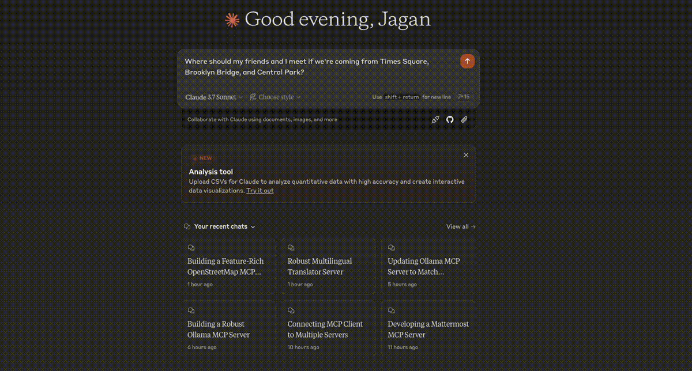
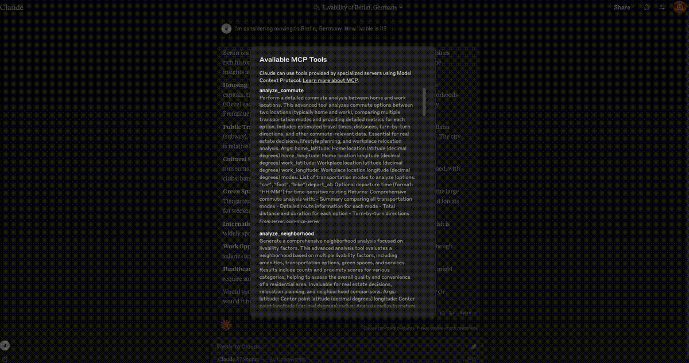
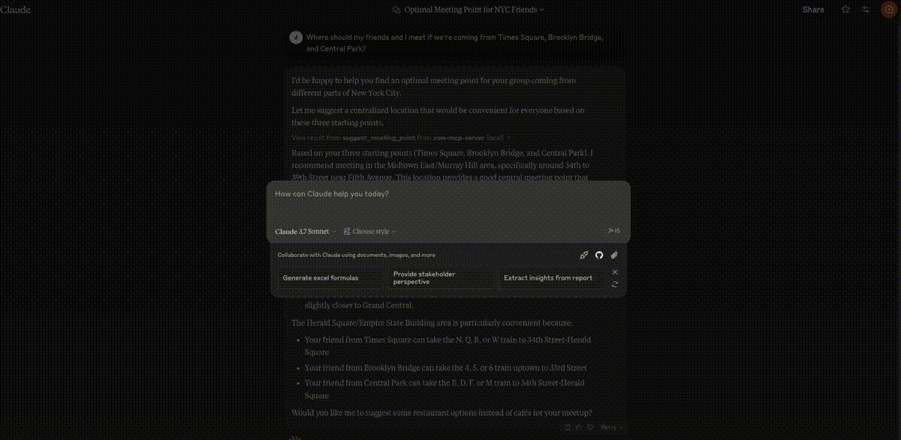

# OpenStreetMap (OSM) MCP Server

An OpenStreetMap MCP server implementation that enhances LLM capabilities with location-based services and geospatial data.

## Demo

### Meeting Point Optimization


### Neighborhood Analysis


### Parking Search



## Installation

### In MCP Hosts like Claude Desktop, Cursor, Windsurf, etc.
- `osm-mcp-server`: The main server, available for public use.
  
  ```json
  "mcpServers": {
    "osm-mcp-server": {
      "command": "uvx",
      "args": [
        "osm-mcp-server"
      ]
    }
  }
  ```

## Features

This server provides LLMs with tools to interact with OpenStreetMap data, enabling location-based applications to:

- Search nearby POIs with provider-facing semantic keywords
- Generate coarse semantic waypoints for hierarchical navigation
- Parse free-form user instructions and recommend destinations with route key waypoints
- Geocode addresses and place names to coordinates
- Reverse geocode coordinates to addresses
- Suggest optimal meeting points for multiple people
- Explore areas and get comprehensive location information
- Find schools and educational institutions near a location
- Analyze commute options between home and work
- Locate EV charging stations with connector and power filtering
- Perform neighborhood livability analysis for real estate
- Find parking facilities with availability and fee information
- Analyze remote images with a multimodal LLM endpoint

## Components

### Resources

The server implements location-based resources:
- `location://place/{query}`: Get information about places by name or address
- `location://map/{style}/{z}/{x}/{y}`: Get styled map tiles at specified coordinates

### Tools

The primary domestic-map-first workflow is built around these tools:
- `search_nearby_pois`: Search nearby POIs with provider-facing semantic keywords such as `bookstore|cafe`
- `get_coarse_waypoints`: Return macro semantic route steps instead of dense geometry
- `recommend_destination_and_waypoints`: Parse natural-language prompts, rank destinations, and return key route waypoints

Additional tools remain available:
- `geocode_address`: Convert text to geographic coordinates
- `reverse_geocode`: Convert coordinates to human-readable addresses
- `suggest_meeting_point`: Find optimal meeting spots for multiple people
- `explore_area`: Get comprehensive data about a neighborhood
- `find_schools_nearby`: Locate educational institutions near a specific location
- `analyze_commute`: Compare transportation options between home and work
- `find_ev_charging_stations`: Locate EV charging infrastructure with filtering
- `analyze_neighborhood`: Evaluate neighborhood livability for real estate
- `find_parking_facilities`: Locate parking options near a destination
- `analyze_image`: Send an image URL plus a question to a multimodal LLM and return the answer

Legacy compatibility tools are still exposed but are no longer the recommended path for new integrations:
- `find_nearby_places`
- `get_route_directions`
- `search_category`

### Provider Configuration (OSM / AMap / Baidu)

By default the server uses OpenStreetMap data sources. You can switch to AMap:

```bash
export MAP_PROVIDER=amap
export AMAP_KEY=your_amap_key
osm-mcp-server
```

You can also switch to Baidu Maps:

```bash
export MAP_PROVIDER=baidu
export BAIDU_AK=your_baidu_ak
osm-mcp-server
```

Optional LLM parsing (for better intent extraction):

```bash
# OpenAI-compatible default
export LLM_API_KEY=your_api_key
export LLM_MODEL=gpt-4o-mini
export LLM_API_BASE_URL=https://api.openai.com/v1

# Doubao / Volcengine ARK via Responses API
export LLM_PROVIDER=ark
export ARK_API_KEY=your_ark_api_key
export LLM_MODEL=doubao-seed-2-0-pro-260215
# Optional override; this is the default when LLM_PROVIDER=ark
export LLM_API_BASE_URL=https://ark.cn-beijing.volces.com/api/v3
# Default in code is now chat_completions; keep this if you want to be explicit.
export LLM_API_STYLE=chat_completions
# Optional: you can still switch to Responses API manually.
# export LLM_API_STYLE=responses
```

Optional prompt-engineering configuration:

```bash
# Few-shot examples for instruction parsing (JSON array).
# Schema per item:
# {
#   "request": "natural language request",
#   "output": {
#     "destination_type": "string",
#     "search_keywords": "string|string",
#     "mode": "car|foot|bike",
#     "radius_m": 1000,
#     "optimize_for": "time|distance|balanced",
#     "max_candidates": 5,
#     "hard_constraints": {
#       "max_route_duration_min": 20,
#       "max_route_distance_m": 4000,
#       "must_include_keywords": ["string", ...],
#       "exclude_keywords": ["string", ...]
#     }
#   }
# }
export LLM_FEW_SHOT_EXAMPLES_JSON='[
  {
    "request": "Find a quiet place to work nearby with coffee",
    "output": {
      "destination_type": "workspace",
      "search_keywords": "cafe|coworking space|bookstore",
      "mode": "car",
      "radius_m": 2500,
      "optimize_for": "balanced",
      "max_candidates": 5,
      "hard_constraints": {
        "max_route_duration_min": 25,
        "max_route_distance_m": null,
        "must_include_keywords": ["coffee"],
        "exclude_keywords": []
      }
    }
  }
]'

# Few-shot examples from file (recommended)
export LLM_FEW_SHOT_EXAMPLES_FILE=config/llm_few_shot_examples.json

# Optional cap for prompt size (defaults to 6)
export LLM_FEW_SHOT_MAX_EXAMPLES=6

# Hard-constraint and soft-ranking controls
export ROUTE_EVAL_LIMIT=25
export RANKING_WEIGHTS_JSON='{"time":0.5,"distance":0.3,"proximity":0.1,"keyword":0.1}'
```


## Local Testing

### Running the Server

To run the server locally:

1. Install the package in development mode:

```bash
pip install -e .
```

2. Start the server:

```bash
osm-mcp-server
```

3. The server will start and listen for MCP requests on the standard input/output.

### Testing with Example Clients

The repository includes example clients in the `examples/` directory.

#### Basic Client Example

`client.py` demonstrates the recommended domestic-map-first workflow:

```bash
python examples/client.py
```

This will:
- Connect to the locally running server
- Get information about San Francisco
- Search nearby POIs with semantic keywords
- Request coarse semantic waypoints to a selected destination
- Run the full recommendation workflow

#### LLM Integration Example

`location_assistant_client.py` provides a helper class designed for LLM integration:

```bash
python examples/location_assistant_client.py
```

This example shows how an LLM can use the Location Assistant to:
- Get location information from text queries
- Search nearby semantic POIs
- Get coarse semantic waypoints
- Find optimal meeting points
- Explore neighborhoods

#### Prompt Recommendation Demo

`prompt_recommendation_client.py` demonstrates free-form prompt recommendation and waypoint sequence output:

```bash
python examples/prompt_recommendation_client.py \
  --prompt "Find a quiet cafe nearby with fast driving access" \
  --lat 37.7749 \
  --lon -122.4194 \
  --mode car \
  --max-candidates 3 \
  --radius 2500
```

#### macOS Interactive Candidate Selection Demo

`macos_prompt_recommendation_client.py` demonstrates an interactive flow:
- read current macOS location (or use fallback `--lat/--lon`)
- generate candidate destinations first
- modify prompt/mode/radius/max-candidates in terminal
- manually pick a destination index
- generate waypoints for the selected destination

```bash
python examples/macos_prompt_recommendation_client.py \
  --prompt "Find a quiet cafe nearby" \
  --mode foot \
  --radius 2500
```

Optional fallback coordinates (non-macOS or when Location Services is unavailable):

```bash
python examples/macos_prompt_recommendation_client.py \
  --prompt "Find a quiet cafe nearby" \
  --mode foot \
  --radius 2500 \
  --lat 39.916527 \
  --lon 116.397128
```

#### Image Understanding Demo

`image_understanding_client.py` demonstrates the multimodal MCP tool:

```bash
python examples/image_understanding_client.py \
  --image-url "https://ark-project.tos-cn-beijing.ivolces.com/images/view.jpeg" \
  --question "What place is shown in this image?"
```

### Writing Your Own Client

To create your own client:

1. Import the MCP client:
```python
from mcp.client import Client
```

2. Initialize the client with your server URL:
```python
client = Client("http://localhost:8000")
```

3. Invoke tools or access resources:
```python
# Example: Geocode an address
results = await client.invoke_tool("geocode_address", {"address": "New York City"})
```

#### Claude Desktop config for local server

On MacOS: `~/Library/Application\ Support/Claude/claude_desktop_config.json`
On Windows: `%APPDATA%/Claude/claude_desktop_config.json`

<details>
  <summary>Development/Unpublished Servers Configuration</summary>
  
  ```json
  "mcpServers": {
    "osm-mcp-server": {
      "command": "uv",
      "args": [
        "--directory",
        "/path/to/osm-mcp-server",
        "run",
        "osm-mcp-server"
      ]
    }
  }
  ```
</details>


## Development

### Building and Publishing

To prepare the package for distribution:

1. Sync dependencies and update lockfile:
```bash
uv sync
```

2. Build package distributions:
```bash
uv build
```

This will create source and wheel distributions in the `dist/` directory.

3. Publish to PyPI:
```bash
uv publish
```

Note: You'll need to set PyPI credentials via environment variables or command flags.

### Debugging

Since MCP servers run over stdio, debugging can be challenging. For the best debugging
experience, we strongly recommend using the [MCP Inspector](https://github.com/modelcontextprotocol/inspector).

You can launch the MCP Inspector via [`npm`](https://docs.npmjs.com/downloading-and-installing-node-js-and-npm) with this command:

```bash
npx @modelcontextprotocol/inspector uv --directory /path/to/osm-mcp-server run osm-mcp-server
```

Upon launching, the Inspector will display a URL that you can access in your browser to begin debugging.
